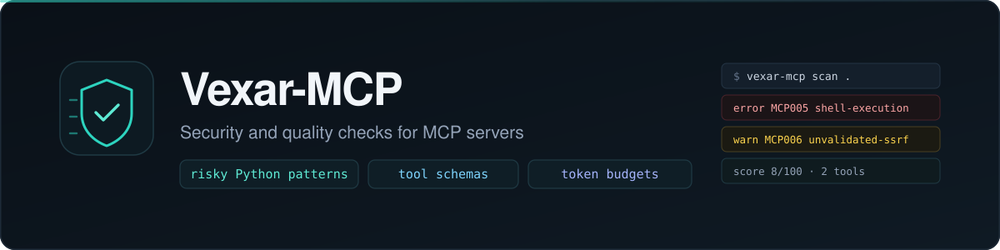

<!-- https://github.com/RANJITHROSAN17/Vexar-MCP -->
<p align="center">
  
</p>

<p align="center">
  <a href="https://github.com/RANJITHROSAN17/Vexar-MCP/actions/workflows/ci.yml"></a>
  <a href="https://github.com/RANJITHROSAN17/Vexar-MCP/releases"></a>
  <a href="https://pypi.org/pypi/vexar-mcp"></a>
  
  <a href="https://github.com/RANJITHROSAN17/Vexar-MCP/blob/main/LICENSE"></a>
  <a href="CODE_OF_CONDUCT.md"></a>
  <br>
  <a href="https://github.com/RANJITHROSAN17/Vexar-MCP/issues?q=is%3Aissue+is%3Aopen+label%3A%22good+first+issue%22"></a>
  <a href="https://github.com/RANJITHROSAN17/Vexar-MCP/issues?q=is%3Aissue+is%3Aopen+label%3A%22help+wanted%22"></a>
  <a href="https://github.com/RANJITHROSAN17/Vexar-MCP/pulls"></a>
  <a href="https://github.com/RANJITHROSAN17/Vexar-MCP/actions"></a>
</p>

<h1 align="center">vexar-mcp</h1>
<p align="center"><b>Static Security Scanner · Schema Linter · Token-Budget Auditor for MCP Servers</b></p>
<p align="center">Enterprise-grade GitHub Actions bot stack. Zero external runtime dependencies. 90.77% test coverage.</p>

---

## 🎯 Product Overview

Every MCP server exposes two invisible failure surfaces:

| Failure Surface | How `vexar-mcp` Handles It |
|---|---|
| **Security sinks + leaked keys** — `subprocess.run(shell=True)`, unvalidated `urlopen`, unconfined `open(path)`, hardcoded `ghp_` / `sk-` / `AKIA` tokens | 11 modular rules detect issues at AST level; `MCP009` (`hardcoded-secret-in-tool`, `ERROR`) stops credential leaks; never executes untrusted code |
| **Schema / token tax** — missing descriptions, `Any` params, unbounded pagination, bloated docstrings | Token-budget calculator + schema validator + 4 reporters (terminal / JSON / SARIF / GitHub) |

**Target:** Python MCP servers (`FastMCP`, official `mcp` SDK, `@tool` decorators) + JSON manifests (OpenAI, Anthropic, `tools/list`).

---

## 🏆 Key Metrics (Live)

| Metric | Value | Source |
|---|---|---|
| **Test Coverage** | `90.77%` (pytest, `--cov-fail-under=85`) | [`tests/`](tests/) |
| **Quality Gates** | 0 `ruff` / 0 `mypy` errors | `CI` (3.10 / 3.11 / 3.12) |
| **Contributor Issues** | `8` open (`#1`–`#8`) — `good first issue` + `help wanted` | [`issues/`](https://github.com/RANJITHROSAN17/Vexar-MCP/issues) |
| **Queued Roadmap** | `15` tasks (`RM-001` → `RM-015`) | [`.github/roadmap.json`](.github/roadmap.json) |
| **Labels** | `23` color-coded | Bot-curated |
| **Bot Workflows** | `11` (7 new + CI / governance / release / dusty / welcome) | [`.github/workflows/`](.github/workflows/) |
| **Community Health** | `100%` | GitHub Insights |
| **Release** | `v0.1.0` (`.whl` + `.tar.gz`) | [`releases/v0.1.0`](https://github.com/RANJITHROSAN17/Vexar-MCP/releases/tag/v0.1.0) |

---

## ⚡ Quickstart

```bash
# Install (direct from repo — no PyPI dependency conflicts)
pip install git+https://github.com/RANJITHROSAN17/Vexar-MCP.git@main

# Or with uv / pipx
uvx --from git+https://github.com/RANJITHROSAN17/Vexar-MCP.git vexar-mcp --help

# Run on a server
vexar-mcp audit examples/clean_server.py

# Use as reusable GitHub Action (composite)
uses: RANJITHROSAN17/Vexar-MCP@main
```

**Output formats:** terminal scorecard (`A+` → `F`, token leaderboards), JSON, SARIF v2.1.0 (GitHub Security tab), GitHub Markdown (`$GITHUB_STEP_SUMMARY`).

---

## 🧩 What It Ships

### Core Engine (`src/mcp_doctor/`)

- **AST Parser** (`python_ast.py`) — `ast.parse` only; never executes untrusted code
- **JSON Loaders** (`loaders/`) — MCP `tools/list`, OpenAI manifest, Anthropic schema
- **Rules** (`rules/`) — 11 modular diagnostics: security sinks (shell, SSRF, path traversal), `MCP009` hardcoded-secret detection (provider token prefixes, bearer credentials, sensitive assignments), schema drift (`Any`, missing descriptions), token overflow, pagination, duplicates
- **Engine** (`engine.py`) — scan → diagnose → score (`0`–`100`) → report; fixed `SIM110` / `SIM102`
- **Reporters** (`reporters/`) — 4 output formats (terminal / JSON / SARIF / GitHub Markdown)
- **CLI** (`cli.py`) — `audit`, `init`, `--format`, `--baseline`, `--stdio`

### Enterprise Bot Stack (7 Flow Suites — All Dynamic / Live)

**Only 3 notification sources — zero noise for contributors:**

| Bot | Trigger | What It Does | Notifies? |
|---|---|---|---|
| **Feature Upgrade** | Daily 09:00 UTC + `push`/`pull_request` | Proposes next queued roadmap item (`RM-009`...) | Silent (opens only if queued) |
| **Issue Raise** | Mon 10:00 UTC + `pull_request` | Opens structured contributor issue (`good first` / `help wanted`) | Silent open (max 8 live) |
| **Issue Resolve** | `pull_request` merge + `push` | Verifies linked fix, closes issue, promotes next queued | Silent (only linked issue) |
| **Code Review** | Every PR event (5+ triggers) | Required gate: `ruff` + `mypy` + `pytest ≥85%` + format + labels | **Only if blocked** |
| **Final Merge** | Your `approved` review + `push` | Confirms all 7 flows; pings **only you** | **Only you** (no auto-merge) |
| **Welcome** | First issue / PR open | One-time greeting + rules link | Single comment |
| **Stale** | Sun 00:00 UTC + `push` | Gentle reminder (>90d); never closes contributor/pinned | Silent reminder |

**Governance layer:** `.github/rulesets/contributor-enforcement.json` (hard branch protection + required checks + linear history), `.github/CODEOWNERS`, `CONTRIBUTOR_RULES.md`, `ENTREPRISE_REPLICATION_GUIDE.md` (4-file replication to other repos).

---

## 🏗 Architecture

```text
Input (Python AST / JSON manifest / @tool decorator)
    │
    ▼
Parser (ast.parse — zero execution of untrusted code)
    │
    ▼
Engine — scan → diagnose (MCP001–MCP008) → score (0–100)
    │
    ▼
Reporters — terminal · JSON · SARIF · GitHub Markdown
    │
    ▼
Output — scorecard + token leaderboard + inline PR annotations
```

**Composite GitHub Action (`action.yml`):** consumable by any repo (`uses: RANJITHROSAN17/Vexar-MCP@main`). Pre-commit hook (`.pre-commit-hooks.yaml`) included.

---

## 📦 Installation & Usage

```python
# Direct install (always current)
pip install git+https://github.com/RANJITHROSAN17/Vexar-MCP.git@main

# Use CLI
vexar-mcp audit examples/clean_server.py --format sarif --output report.sarif

# Composite action (in your CI)
- uses: RANJITHROSAN17/Vexar-MCP@main
```

---

## 🛡 Security & Governance

- **No secrets / tokens** in source; use `os.environ.get()` + `.env` (not committed)
- **Security issues:** email (see [`SECURITY.md`](SECURITY.md)) — never open public issue
- **Contributor rules:** [`CONTRIBUTOR_RULES.md`](CONTRIBUTOR_RULES.md) — 8 enforceable rules (`R1` conventional commits → `R8` bot silence + ethics)
- **Ruleset:** [`.github/rulesets/contributor-enforcement.json`](.github/rulesets/contributor-enforcement.json) — restricts updates, requires linear history, 1 review, code-owner, required status checks
- **CODEOWNERS:** required for `src/`, `.github/workflows/`, protected files
- **Dependabot:** grouped (`groups:`) — max 2 PRs/week per ecosystem + `versioning-strategy: increase-if-necessary`

---

## 🔗 Links

| Resource | Link |
|---|---|
| Repository | [`github.com/RANJITHROSAN17/Vexar-MCP`](https://github.com/RANJITHROSAN17/Vexar-MCP) |
| Release | [`v0.1.0`](https://github.com/RANJITHROSAN17/Vexar-MCP/releases/tag/v0.1.0) |
| Live Dashboard | [`assets/dashboard.html`](assets/dashboard.html) (interactive status) |
| Contributor Issues | [`#1` – `#8`](https://github.com/RANJITHROSAN17/Vexar-MCP/issues) |
| Roadmap (15 queued) | [`.github/roadmap.json`](.github/roadmap.json) |
| Architecture | [`ARCHITECTURE.md`](ARCHITECTURE.md) |
| Bot Replication Guide | [`ENTREPRISE_REPLICATION_GUIDE.md`](ENTREPRISE_REPLICATION_GUIDE.md) |
| Security Policy | [`SECURITY.md`](SECURITY.md) |

---

<p align="center"></p>
<p align="center"><sub>Enterprise-grade bot stack · 11 workflows · 100% Community Health · Only 3 notification sources · Zero auto-merge</sub></p>
