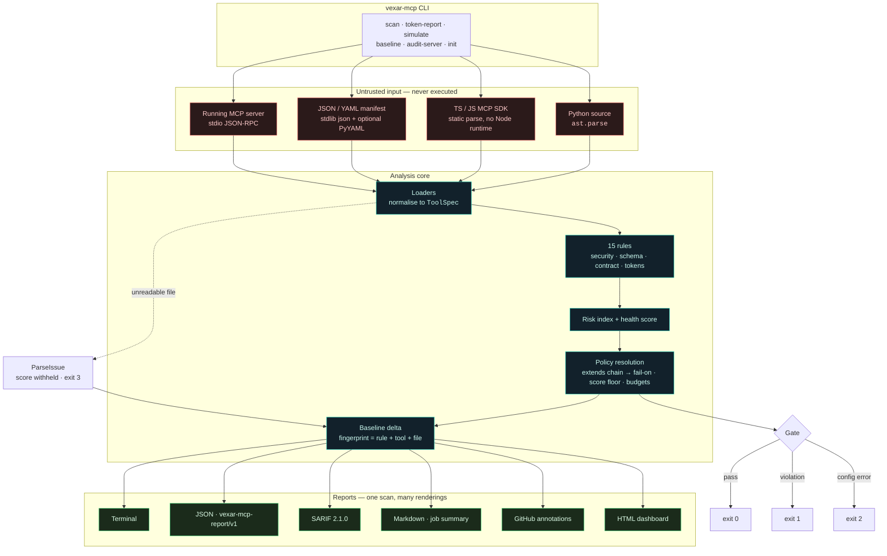
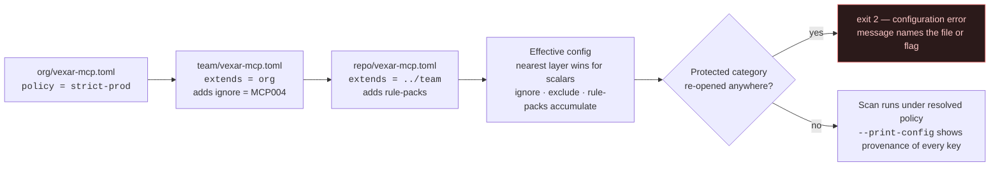

<!-- ============================================================================ -->
<!--  Vexar-MCP · README                                                          -->
<!--  Banner + badges are centred; everything below is developer-facing.          -->
<!--  The demo asset is generated by scripts/make_demo_svg.py and CI fails on     -->
<!--  drift, so it can never show output the tool does not produce.               -->
<!-- ============================================================================ -->

<p align="center">
  
</p>

<h1 align="center">Vexar-MCP</h1>

<p align="center">
  <strong>Static security, schema and token-cost analysis for Model Context Protocol servers — with a policy gate for CI.</strong><br>
  Find the risky pattern, the untyped argument, and the context-window tax <em>before</em> you ship the tool.
</p>

<p align="center">
  <a href="https://github.com/RANJITHROSAN17/Vexar-MCP/actions/workflows/ci.yml"></a>
  <a href="./LICENSE"></a>
  <a href="https://github.com/RANJITHROSAN17/Vexar-MCP/releases"></a>
  <a href="https://github.com/RANJITHROSAN17/Vexar-MCP/stargazers"></a>
  <a href="https://github.com/RANJITHROSAN17/Vexar-MCP/issues"></a>
</p>

<p align="center">
  
  
  
  
  
  
  
  
</p>

<p align="center">
  <a href="./QUICKSTART.md">Quickstart</a> ·
  <a href="#quick-start">Quick start</a> ·
  <a href="#see-it-work">Example output</a> ·
  <a href="#what-it-checks">Rules</a> ·
  <a href="#usage-guide">Usage</a> ·
  <a href="./docs/policies.md">Policies</a> ·
  <a href="./docs/baseline.md">Baselines</a> ·
  <a href="./docs/live-audit.md">Live audit</a> ·
  <a href="./ARCHITECTURE.md">Architecture</a> ·
  <a href="./CONTRIBUTING.md">Contributing</a>
</p>

---

## What this is

Every tool an MCP server exposes becomes **prompt context the model pays for on every turn** — and every tool argument becomes **an input an attacker can try to control**. That produces two failure modes that are trivially easy to ship and very hard to notice in review: a handler that pipes a model-chosen string into `shell=True` or raw SQL, and a tool catalogue so thin the model can't route to it or so fat it taxes every single request.

**Vexar-MCP finds both, statically, in one command** — then keeps them from coming back by gating the result in CI under a named, reviewable policy. It reads your code with `ast.parse` and never executes it, so auditing a third-party server is safe.

### Why it isn't just another linter

|  |  |
| :--- | :--- |
| **It reads, never runs.** | Python is parsed with `ast.parse`; manifests with the standard library. Your server is never imported, so auditing someone else's code is safe. Scanning is fully offline. |
| **It refuses to guess.** | A scan that could not parse your files is **never graded**. You get `Health Score: n/a`, `Status: PARTIAL`, and **exit `3`** — not a comforting `100/100`. |
| **It gates, not just reports.** | One policy name (`strict-prod`, `enterprise-governance`) applies the same fail-on threshold, score floor and token budget on a laptop and in CI. |
| **It is honest about limits.** | What it *cannot* catch is written down in [`docs/limitations.md`](./docs/limitations.md) rather than implied. |

> **Not a replacement for a security review.** It catches a specific, documented set of MCP failure modes early, and makes the standard you enforce explicit and reviewable.

### Demo

<p align="center">
  
</p>

<p align="center">
  <sub>Generated from real output by <a href="./scripts/make_demo_svg.py"><code>scripts/make_demo_svg.py</code></a> — if the tool changes, so does this animation. CI fails when it drifts.</sub>
</p>

---

## ✨ Key Features

- 🔒 **15 built-in rules across 4 categories** — security (`MCP001`–`MCP015`), schema quality, contract/ergonomics, and token budgets. All findings carry a **stable rule ID**, exact `file:line`, severity, category, and a **concrete remediation**.
- 🧠 **Taint-aware sink detection** — traces tool parameters into `shell=True`, `os.system`, `eval`, `exec`, outbound HTTP, filesystem paths, SQL `.execute(...)`, and unsafe deserialization. Taint propagates **one hop into module-local helpers**, so a tool that delegates to a private `_run_cmd()` is no longer invisible.
- 🚫 **Ungraded, not falsely clean** — unreadable inputs become a `ParseIssue`; the score is withheld (`null`), status is `partial`, exit code is `3`. "Nothing found" and "nothing read" can never be confused.
- 🛡️ **Protected rules that cannot be silenced** — under `strict-prod`, `--ignore MCP005` is a **hard configuration error**, not a quiet downgrade. The most common way a security gate dies is being defeated one exemption at a time.
- 🏛️ **Policy inheritance (`extends`)** — org → team → repo chains. Nearest layer wins for scalars; `ignore`, `exclude` and `rule-packs` accumulate. Protected categories accumulate **monotonically**: no layer in the chain can re-open them.
- 🧾 **Six report formats from one scan** — terminal, JSON (`vexar-mcp-report/v1`), SARIF 2.1.0, Markdown, GitHub annotations (`::error` on PR diff lines), and a self-contained offline **HTML dashboard**.
- 💸 **Token-cost auditing** — per-tool context leaderboard (`token-report`) and monthly bill projection (`simulate`) priced against a dated, explicit model table.
- 🩺 **Live server auditing** — `audit-server` speaks stdio JSON-RPC, negotiates the protocol revision the server actually supports, follows `tools/list` pagination, and runs the full rule set over runtime-generated tools.
- 🧱 **Adopt-on-dirty-code baselines** — fingerprint findings as `rule + tool + file`, commit the baseline, and fail **only on new violations**.
- 🧩 **Rule packs without forking** — declarative TOML/JSON organization rules. The `MCP` namespace is reserved so a pack can never impersonate a built-in check.
- 🐍 **Zero runtime dependencies on Python 3.11+** — `tomli` is installed only on 3.10; PyYAML is an **optional extra** only for YAML manifests.
- 🤖 **Composite GitHub Action** — inline PR annotations, SARIF upload, job summary, and step outputs (`status`, `score`, `grade`, `risk-index`, `new-findings`, `analysis-complete`, `files-failed`, `exit-code`).

---

## 🧰 Tech Stack

| Layer | Technology | Why it is here |
| :--- | :--- | :--- |
| **Language** |  | Stdlib `ast` is the parser; no build toolchain to audit your own code. |
| **CLI** |  | Subcommands with no runtime framework dependency. |
| **Packaging** |   | `src/` layout, `py.typed` marker, console script `vexar-mcp`. |
| **Config** |  | `vexar-mcp.toml`, `.mcp-doctor.toml`, or `[tool.vexar-mcp]` in `pyproject.toml`. |
| **Manifests** |   | MCP `tools/list`, OpenAI & Anthropic tool schemas; TS/JS parsed statically. |
| **Protocol** |  | Live audit across five protocol revisions, handshake **and** stateless discovery. |
| **Types** |  | `strict = true` in `pyproject.toml`; all public API typed. |
| **Lint / test** |   | CI enforces `--cov-fail-under=85`. |
| **CI/CD** |  | Release chain: tag → GitHub Release → PyPI → clean-venv install smoke test. |
| **Outputs** |   | Code Scanning, PR annotations, offline dashboards. |

---

## 🏗️ Architecture & System Flow

### Scan lifecycle



The dotted path is the whole thesis: a file that cannot be read becomes a **`ParseIssue`**, not an empty result. The report and the exit code both record that analysis was incomplete.

### Policy resolution (`extends` chains)



### Repository layout

```text
src/mcp_doctor/
├── cli.py                 # argparse surface: scan, audit-server, baseline, policy, rules,
│                          # token-report, simulate, init
├── engine.py              # discovery → load → rule execution → report assembly
├── models.py              # ToolSpec, ParameterSpec, Diagnostic, ScanReport, ScanConfig
├── policies.py            # presets + the protected-rule invariant
├── config.py              # TOML / pyproject loading, extends resolution, provenance
├── baseline.py            # accepted-risk snapshots and delta gating
├── risk.py                # deterministic risk index
├── tokens.py              # the single offline token estimator
├── live.py                # stdio JSON-RPC client (argv-only, deadline, caps)
├── loaders/               # python_ast · typescript_loader · json_manifest · yaml_manifest
├── rules/                 # security · schema · contract · token rules + plugin packs
├── reporters/             # terminal · json · sarif · markdown · github_actions · html
└── simulate/cost_model.py # dated model price table → monthly projection
```

Full internals: [`ARCHITECTURE.md`](./ARCHITECTURE.md).

---

## 📋 Prerequisites

| Requirement | Version | Notes |
| :--- | :--- | :--- |
| **Python** | `>= 3.10` | Declared in `pyproject.toml`. Tested on 3.10–3.13. |
| **pip** | any recent | `pip install "git+https://github.com/RANJITHROSAN17/Vexar-MCP.git@main"` |
| **Git** | any | Only for installing from source. |
| **PyYAML** *(optional)* | `>= 6.0.1` | Needed **only** for `.yaml` manifests: `pip install user/vexar-mcp[yaml]` |
| **Node.js** *(optional)* | — | **Not required.** TypeScript/JS servers are parsed statically. |
| **Docker** *(optional)* | — | Not required by the tool; handy if you want to audit a containerised server. |

Runtime dependencies: **none** on Python 3.11+. On 3.10, `tomli>=2.0.1` is installed automatically.

---

## Quick start

**Requirements:** Python 3.10+. No runtime dependencies on Python 3.11+.
**Time:** about two minutes. New to the project? [`QUICKSTART.md`](./QUICKSTART.md) walks the
same path and shows the output to expect at each step.

```bash
# 1. Install (from source -- there is no PyPI release of this package yet)
pip install "git+https://github.com/RANJITHROSAN17/Vexar-MCP.git@main"

# 2. See it catch real problems in an intentionally broken example
vexar-mcp scan examples/

# 3. Point it at your own server and enforce a policy
vexar-mcp scan path/to/your_mcp_server --policy strict-prod
```

That is the whole on-ramp. **If step 2 prints findings and step 3 exits `1`, it is working.**

<details>
<summary><strong>Developing on Vexar-MCP itself</strong></summary>

```bash
git clone https://github.com/RANJITHROSAN17/Vexar-MCP.git
cd Vexar-MCP
python3 -m venv .venv
source .venv/bin/activate          # Windows: .venv\Scripts\activate
python -m pip install -e ".[dev]"
```

Add `.[yaml]` alongside `.[dev]` if you want the YAML manifest loader:

```bash
python -m pip install -e ".[dev,yaml]"
```

Then run the same gate CI runs:

```bash
ruff check . && mypy src && pytest --cov=mcp_doctor --cov-fail-under=85
```
</details>

<details>
<summary><strong>Scaffold a project in one command</strong></summary>

```bash
vexar-mcp init . --policy strict-prod --github-action
```

Writes `vexar-mcp.toml` **and** `.github/workflows/vexar-mcp.yml`, ready to commit. Use
`--dry-run` to preview, `--force` to overwrite.
</details>

> **PyPI status:** not published yet -- the import name is already owned on PyPI, tracked as
> **D1** in [`docs/roadmap-90-days.md`](./docs/roadmap-90-days.md). The source install above is
> the supported path.

---

## ⚙️ Configuration & Environment Variables

### Configuration keys

Settings resolve in this precedence order (highest wins **for scalars**): **CLI flags → `vexar-mcp.toml` (nearest) → `extends` chain → selected policy preset → built-in defaults**.

Vexar-MCP reads `vexar-mcp.toml`, `.mcp-doctor.toml`, or a `[tool.vexar-mcp]` / `[tool.mcp-doctor]` table in `pyproject.toml`.

| Key | Type | Default | Required | Description |
| :--- | :--- | :--- | :---: | :--- |
| `extends` | string | — | no | Preset name (`"strict-prod"`) **or** path to another config file to inherit from. Chains nest; cycles and chains > 16 levels are exit `2`. |
| `policy` | string | `default` | no | Enforcement preset: `default`, `ci`, `strict-prod`, `enterprise-governance`. |
| `fail-on` | string | preset-dependent | no | Minimum severity that fails the run: `error`, `warning`, `info`, `never`. |
| `min-score` | int | preset-dependent | no | Fail when the health score is below this value (`0`–`100`). |
| `max-tool-tokens` | int | `250` | no | Per-tool token budget before `MCP002` fires. |
| `max-server-tokens` | int | preset-dependent | no | Whole-catalogue budget before `MCP014` fires. |
| `ignore` | list[string] | `[]` | no | Rule IDs to silence project-wide. Ignoring a **protected** rule is a configuration error. |
| `exclude` | list[string] | built-in list | no | Directories never walked. **Replaces** the built-in list, so keep it complete. |
| `rule-packs` | list[string] | `[]` | no | Opt-in pack specs: `.toml` / `.json` paths, or a trusted Python module path. |
| `baseline` | string | — | no | Path to a committed baseline; gate then applies to **new** findings only. |

**Example `vexar-mcp.toml`:**

```toml
# Org standard is inherited; this file narrows only what this repo must.
extends     = "../org/vexar-mcp.toml"
policy      = "strict-prod"
fail-on     = "warning"
min-score   = 90

ignore      = ["MCP004"]                  # info-level; protected rules would be rejected
exclude     = [".git", ".venv", "node_modules", "dist", "build", "__pycache__"]
rule-packs  = ["./policies/acme-rules.toml"]
baseline    = ".vexar-baseline.json"
```

Inspect exactly what will be enforced, and **which file contributed each setting**:

```bash
vexar-mcp scan . --print-config
```

### Environment variables

Vexar-MCP is deliberately **configuration-file driven** — it reads **no application secrets or API keys**, and makes **no network calls** during a scan. The variables below are the ones that affect behaviour, all owned by the CI platform rather than the tool:

| Variable | Owner | Default | Required | Purpose |
| :--- | :--- | :--- | :---: | :--- |
| `GITHUB_STEP_SUMMARY` | GitHub Actions | — | no | When set (and the action's `step-summary: true`), the Markdown report is appended to the job summary. |
| `GITHUB_OUTPUT` | GitHub Actions | — | no | Where the action writes `score`, `grade`, `risk-index`, `new-findings`, `analysis-complete`, `files-failed`, `exit-code`. |
| `GITHUB_ACTION_PATH` | GitHub Actions | — | no | Used by `action.yml` to locate `.github/scripts/action_outputs.py`. |
| `INPUT_*` (`INPUT_PATH`, `INPUT_POLICY`, `INPUT_FAIL_ON`, `INPUT_BASELINE`, …) | GitHub Actions | mapped from `with:` | no | Action input → CLI flag bridge. You set these via `with:` keys, not manually. |
| `VIRTUAL_ENV` / `PATH` | shell | — | no | Standard venv activation so `vexar-mcp` resolves on `PATH`. |

> **No `.env` file is required or read.** If you were expecting `API_KEY`-style variables: there are none by design. Scanning is offline, and `MCP009` records only the *shape* of a credential match — never the literal value — so a report can never become a second copy of a leaked key.

---

## 📖 Usage Guide

### CLI command surface

```text
vexar-mcp scan [PATHS...]        # static analysis: files, dirs, manifests
vexar-mcp token-report [PATHS...] # per-tool context-window leaderboard
vexar-mcp simulate [PATHS...]     # monthly $ projection for a model + volume
vexar-mcp audit-server -- CMD...  # live stdio JSON-RPC audit
vexar-mcp baseline write|show     # accepted-risk snapshots
vexar-mcp policy                  # list enforcement presets
vexar-mcp rules                   # list the 15 rules
vexar-mcp init [DIRECTORY]        # scaffold config (+ CI workflow)
```

### Scan

```bash
# Whole repository
vexar-mcp scan .

# A single server, a JSON manifest, and a YAML manifest in one run
vexar-mcp scan src/server.py tools.json tools.yaml

# Release gate
vexar-mcp scan . --policy strict-prod

# Explicit gates
vexar-mcp scan . --fail-on warning --min-score 90 --max-tokens 200

# Rule packs (repeatable)
vexar-mcp scan . --rule-pack ./policies/acme-rules.toml --rule-pack ./policies/rgpd.json

# Fail when the target contains nothing recognizable (exit 4)
vexar-mcp scan . --fail-on-no-matches

# Machine-readable outputs, one scan
vexar-mcp scan . --format json --output report.json
vexar-mcp scan . --format sarif --output vexar.sarif
vexar-mcp scan . --format markdown --output summary.md
vexar-mcp scan . --format github              # inline ::error / ::warning on PR lines
vexar-mcp scan . --format html --output report.html

# One scan, many artefacts — the format is rendered from a single analysis
vexar-mcp scan . --emit sarif=out.sarif --emit html=report.html --emit json=-
```

### Auditing a running server

```bash
# Standard: launch the server yourself; argv-only, no shell
vexar-mcp audit-server -- python my_server.py

# A published server, with SARIF output
vexar-mcp audit-server --format sarif --output live.sarif -- npx -y @acme/mcp-server
```

It negotiates the revision the server actually speaks, follows `tools/list` pagination, validates conformance (`MCP012`), then runs the full rule set over the tools that are really exposed — through the same normalisation pipeline as file scans, so results are directly comparable with a static baseline.

| Revision | Negotiation | Notes |
| :--- | :--- | :--- |
| `2026-07-28` | `stateless` | Current. No handshake; version per request in `_meta`, agreed via `server/discover`. |
| `2025-11-25` | `handshake` | Last initialization-based revision. |
| `2025-06-18` | `handshake` | |
| `2025-03-26` | `handshake` | |
| `2024-11-05` | `handshake` | |

Bounded by a hard deadline, an 8 MiB response cap and a 50-page cap; the child is killed on expiry. This is the **only** command that starts a process.

### Token cost

```bash
vexar-mcp token-report examples/

vexar-mcp simulate . --model claude-sonnet-4.5 --calls-per-day 2000

# Your negotiated contract rate, for a model not in the reviewed table
vexar-mcp simulate . --model my-finetune --input-price 0.80 --calls-per-day 5000
```

```console
$ vexar-mcp token-report examples/clean_server.py examples/tools_manifest.json
TOOL NAME                         EST. TOKENS   PARAMS  SOURCE
------------------------------------------------------------------------------
list_kubeflow_runs                        186        2  examples/tools_manifest.json:1
read_workspace_note                       142        2  examples/clean_server.py:24
check_package_metadata                     97        1  examples/clean_server.py:41
------------------------------------------------------------------------------
Total context-window tax across 3 tool(s): ~425 tokens/turn
```

Prices are a **dated, explicit input** (`PRICING_AS_OF = "2026-10"`); an unknown model raises rather than silently falling back. Counts are deterministic offline estimates, not a tokenizer round-trip — see [`docs/limitations.md`](./docs/limitations.md).

### Adopting a gate on dirty code

```bash
vexar-mcp scan . --write-baseline .vexar-baseline.json     # accept what exists today
vexar-mcp scan . --baseline .vexar-baseline.json           # fail only on what's new
vexar-mcp baseline show .vexar-baseline.json               # inspect accepted risk
```

### Programmatic API (Python)

```python
from pathlib import Path

from mcp_doctor import ScanConfig, scan_paths
from mcp_doctor.reporters.json_reporter import render_json

report = scan_paths([Path("src/")], ScanConfig())

print(report.status.value)  # clean | findings | partial | no_matches | error
print(report.summary.score)  # int | None -> None when ungraded. Never default it to 100.
print(report.summary.grade)  # "A+" ... "F" | "n/a"
print(report.coverage.files_analyzed, report.coverage.files_failed)

for diag in report.diagnostics:
    print(f"{diag.rule_id} {diag.source_file}:{diag.line} — {diag.message}")
    print(f"  fix: {diag.remediation}")

Path("report.json").write_text(render_json(report))
```

### JSON report shape (`vexar-mcp-report/v1`)

Additive-only within a minor release: existing keys never disappear or change type.

```json
{
  "schema": "vexar-mcp-report/v1",
  "version": "0.2.6",
  "policy": { "name": "strict-prod" },
  "status": "partial",
  "analysis_complete": false,
  "live": null,
  "coverage": {
    "candidate_files": 2,
    "files_analyzed": 1,
    "files_failed": 1,
    "files_with_tools": 1,
    "tools_analyzed": 2
  },
  "summary": {
    "files_scanned": 2,
    "tools_scanned": 2,
    "total_estimated_tokens": 105,
    "errors": 4,
    "warnings": 5,
    "infos": 3,
    "total_diagnostics": 12,
    "score": null,
    "grade": "n/a",
    "risk_index": 41,
    "risk_band": "elevated"
  },
  "parse_issues": [
    {
      "kind": "syntax_error",
      "source_file": "src/servers/broken.py",
      "line": 6,
      "message": "SyntaxError: invalid syntax"
    }
  ],
  "tools": [
    { "name": "run", "source_file": "examples/vulnerable_server.py", "line": 23,
      "estimated_tokens": 52, "parameter_count": 1 }
  ],
  "diagnostics": [
    {
      "rule_id": "MCP005",
      "rule_slug": "dangerous-shell-execution",
      "severity": "error",
      "category": "security",
      "tool_name": "run",
      "source_file": "examples/vulnerable_server.py",
      "line": 25,
      "message": "Tool 'run' invokes dangerous execution sink `subprocess.run(shell=True)` with parameter 'cmd'.",
      "remediation": "Use `subprocess.run([cmd, arg], shell=False, check=True)` with validated arguments.",
      "risk": 9,
      "fingerprint": "MCP005:run:examples/vulnerable_server.py"
    }
  ]
}
```

### CI integration

```yaml
name: MCP audit
on: [pull_request]

permissions:
  contents: read
  security-events: write      # only if you upload SARIF

jobs:
  audit:
    runs-on: ubuntu-latest
    steps:
      - uses: actions/checkout@v4

      - uses: RANJITHROSAN17/Vexar-MCP@main
        id: vexar
        with:
          path: .
          policy: strict-prod
          sarif-output: vexar-mcp.sarif
          step-summary: true
          allow-incomplete: false   # an unreadable file fails the job

      - run: echo "score=${{ steps.vexar.outputs.score }} grade=${{ steps.vexar.outputs.grade }}"

      - uses: github/codeql-action/upload-sarif@v3
        if: always()
        with:
          sarif_file: vexar-mcp.sarif
```

| Action input | Default | Purpose |
| :--- | :--- | :--- |
| `path` | `.` | File or directory to scan. |
| `policy` | — | Preset; overrides individual gates. |
| `fail-on` | preset | `error` \| `warning` \| `info` \| `never`. |
| `min-score` | preset | Score floor (`0`–`100`). |
| `max-tokens` | preset | Per-tool token budget. |
| `ignore` | — | Comma-separated rule IDs. Protected rules are rejected. |
| `baseline` | — | Committed baseline; only new findings fail. |
| `rule-packs` | — | Comma-separated pack specs. |
| `config` | — | Explicit config path. |
| `sarif-output` | — | SARIF v2.1.0 path for Code Scanning. |
| `html-output` | — | Standalone HTML dashboard path. |
| `step-summary` | `true` | Append Markdown to the job summary. |
| `allow-incomplete` | `false` | Do **not** fail on unanalyzable files. Off by default. |

---

## What it checks

Fifteen rules across four categories — fourteen static, plus `MCP012` for live protocol conformance. `vexar-mcp rules --format json` emits the machine-readable catalog.

| Rule | Severity | Category | Flags |
| :--- | :--- | :--- | :--- |
| `MCP001` | error | contract | Tool has no meaningful description (`< 12` chars), degrading tool selection |
| `MCP002` | warning | tokens | A single tool definition exceeds the per-tool token budget (default `250`) |
| `MCP003` | warning | schema | Parameter has no type annotation, or uses unconstrained `Any` / bare `dict` |
| `MCP004` | info | schema | Pagination / `limit` / batch parameter has no upper bound |
| `MCP005` | error | security | `shell=True`, `os.system`, `eval`, `exec` reached from a tool handler |
| `MCP006` | warning | security | Tool input flows into an outbound HTTP call without visible host/scheme validation |
| `MCP007` | warning | security | Tool input flows into a filesystem path without base-directory confinement |
| `MCP008` | error | contract | Duplicate, generic, or non-conforming tool name |
| `MCP009` | error | security | Hardcoded credential literal inside a tool handler (provider prefixes, bearer headers) — **never echoes the value** |
| `MCP010` | warning | security | Outbound HTTP call with no explicit `timeout=` |
| `MCP011` | error | security | SQL built by interpolating tool input into `.execute(...)` / `.executemany(...)` |
| `MCP012` | warning | contract | **Live only:** unsupported revision, missing `tools` capability, malformed `tools/list` entries, runaway pagination |
| `MCP013` | error | security | `pickle.loads`, `yaml.load` without `SafeLoader`, and similar unsafe deserialization |
| `MCP014` | warning | tokens | Whole catalogue exceeds the server-wide token budget, naming its largest contributors |
| `MCP015` | info | schema | A tool's parameters have no description, so the model must guess their meaning |

Rules are **static pattern and data-flow heuristics, not proof of exploitability.** Read [`docs/limitations.md`](./docs/limitations.md) before treating a finding as a confirmed vulnerability. Per-rule detail and remediation: [`docs/rules.md`](./docs/rules.md).

## See it work

### Example output

```console
$ vexar-mcp scan examples/vulnerable_server.py
==============================================================================
Vexar-MCP  |  Health Score: 4/100 (F)  |  Tools: 2 across 1 file(s)
Context Footprint: ~105 tokens  |  Errors: 4  Warnings: 5  Info: 3
==============================================================================

[ERROR] MCP001 (missing-tool-description) at examples/vulnerable_server.py:23 [run]
        Tool 'run' has an empty or overly brief description (0 chars; minimum 12 recommended).
        Fix: Document purpose, inputs, and side effects in the tool docstring or `description`.
[ERROR] MCP008 (ambiguous-or-duplicate-tool-name) at examples/vulnerable_server.py:23 [run]
        Tool name 'run' is overly generic or violates `[a-z][a-z0-9_-]{2,63}`.
        Fix: Use specific `verb_noun` `snake_case` naming such as `fetch_invoice_summary`.
[WARN ] MCP003 (untyped-or-any-parameter) at examples/vulnerable_server.py:23 [run]
        Parameter 'cmd' in tool 'run' has no type annotation.
        Fix: Provide an explicit scalar, `Literal[...]`, `TypedDict`, or Pydantic `BaseModel` type.
...
[ERROR] MCP005 (dangerous-shell-execution) at examples/vulnerable_server.py:25 [run]
        Tool 'run' invokes dangerous execution sink `subprocess.run(shell=True)` with parameter 'cmd'.
        Fix: Use `subprocess.run([cmd, arg], shell=False, check=True)` with validated arguments.
```

A reference implementation that passes every rule scores 100:

```console
$ vexar-mcp scan examples/clean_server.py examples/tools_manifest.json
==============================================================================
Vexar-MCP  |  Health Score: 100/100 (A+)  |  Tools: 3 across 2 file(s)
Context Footprint: ~425 tokens  |  Errors: 0  Warnings: 0  Info: 0
==============================================================================
All checks passed! Zero security, schema, contract, or token-budget findings.
```

### Scan status & exit codes

A passing gate must mean *"we read your code and it is fine"* — not *"we found nothing to read."*

| Status | Meaning | Graded | Exit |
| :--- | :--- | :---: | :---: |
| `clean` | Everything analyzed, nothing fired | ✅ | `0` |
| `findings` | Everything analyzed, issues found | ✅ | `0` / `1` |
| `partial` | Some files could not be read — **not a clean result** | ❌ | `3` |
| `no_matches` | Nothing recognizable was found | ❌ | `0` (`4` with `--fail-on-no-matches`) |
| `error` | Nothing could be analyzed | ❌ | `3` |

Exit codes: **`0`** pass · **`1`** a gate failed · **`2`** bad invocation or configuration · **`3`** incomplete analysis · **`4`** nothing matched. Details: [`docs/scan-status.md`](./docs/scan-status.md).

### Policy presets

| Preset | Fails on | Score floor | Token budget / tool | Unignorable |
| :--- | :--- | :---: | :---: | :--- |
| `default` | `error` | — | 250 | — |
| `ci` | `warning` | 80 (B) | 230 | security |
| `strict-prod` | `warning` | 90 (A) | 200 | security |
| `enterprise-governance` | `info` | 97 (A+) | 180 | security, contract |

A protected rule **cannot** be ignored — not from the CLI, not from a config file:

```console
$ vexar-mcp scan . --policy strict-prod --ignore MCP005
vexar-mcp: error: policy 'strict-prod' protects security rules; these cannot be ignored: MCP005.
```

### Report formats

| Format | Flag | Intended use |
| :--- | :--- | :--- |
| Terminal | *(default)* | Local development, scorecard and diagnostics |
| JSON | `--format json` | Your own tooling, dashboards, artifact storage |
| SARIF | `--format sarif` | GitHub Code Scanning, any SARIF-consuming IDE |
| Markdown | `--format markdown` | `$GITHUB_STEP_SUMMARY`, PR comments |
| Annotations | `--format github` | Inline `::error` / `::warning` / `::notice` on PR diff lines — no Advanced Security needed |
| HTML | `--format html --output report.html` | One self-contained file: scorecards, filters, search, tool costs, trend sparkline. No CDN, works offline |

### Rule packs

```toml
[[rule]]
id = "ACME001"
slug = "acme-tools-must-be-namespaced"
severity = "warning"
category = "contract"
summary = "All tools must live in the acme_ namespace."
remediation = "Rename the tool with an acme_ prefix."
message = "Tool '{tool}' is outside the ACME namespace."
  [rule.match]
  name_regex = "^acme_"
  invert = true
```

```bash
vexar-mcp scan . --rule-pack ./policies/acme-rules.toml
```

Declarative packs are **data, never executed** — the recommended format. The `MCP` rule-ID namespace is reserved, so a pack can never shadow a built-in check. See [`docs/rule-packs.md`](./docs/rule-packs.md).

---

## 🧪 Testing & Verification

Run the full quality gate locally before pushing — this is exactly what CI enforces:

```bash
# Lint + format
ruff check .
ruff format --check .

# Strict type checking (33 source files)
mypy src

# Test suite with coverage gate (CI fails under 85%)
pytest --cov=mcp_doctor --cov-report=term-missing --cov-fail-under=85

# Release wiring: version / tag / changelog agreement
python scripts/verify_release.py

# Validate the 15 CI workflow files
python .github/scripts/validate_workflows.py

# Validate the roadmap bot manifest
python .github/scripts/sync_roadmap_issues.py --dry-run
```

Targeted suites worth knowing:

```bash
pytest tests/test_rules.py                    # rule correctness, positive + negative cases
pytest tests/test_analysis_completeness.py    # the "never let an incomplete scan look clean" contract
pytest tests/test_policies.py tests/test_policy_inheritance.py
pytest tests/test_baseline.py tests/test_live.py tests/test_loaders.py
```

Dogfood the gate against this repository:

```bash
vexar-mcp scan . --policy strict-prod          # the project scans itself with vexar-mcp.toml
vexar-mcp scan examples/clean_server.py        # must score 100/A+ under every preset
```

CI also assert-fails deliberately: `examples/` contains an intentionally insecure server, and a `ci` gate **must** return non-zero on it. A gate that cannot fail proves nothing.

---

## 🗺️ Roadmap

Shipped:

- [x] Core contract — what a finding, a pass, and a failure mean
- [x] Stable, documented exit codes (`0` pass · `1` gate · `2` config · `3` incomplete · `4` no matches)
- [x] Partial/incomplete analysis behaviour with withheld scores
- [x] Policy presets (`default`, `ci`, `strict-prod`, `enterprise-governance`)
- [x] Baselines — adopt current findings, fail on new ones only
- [x] SARIF 2.1.0, JSON, Markdown, GitHub annotation and offline HTML reporters
- [x] Composite GitHub Action with step outputs and job summary
- [x] Live server auditing across five protocol revisions (handshake + stateless)
- [x] TypeScript/JS MCP SDK static parsing (no Node runtime required)
- [x] Organization/team **policy inheritance** with monotonic protection
- [x] One-hop taint propagation into module-local helpers
- [x] Rule packs without forking the tool
- [x] Honest [`limitations.md`](./docs/limitations.md)

Planned:

- [ ] **JSON Schema for machine contracts** — report and baseline artifacts published as versioned schemas
- [ ] **SARIF output validated against the official schema** — currently tested for content, not conformance
- [ ] **Expanded benchmark corpus** — 5–10 vulnerable + 5 clean servers with expected findings
- [ ] **PyPI availability** — unblocked once the import-name collision (D1) is resolved
- [ ] **Release discipline** — align `pyproject.toml` version with the latest published release
- [ ] **Autofix companion** — [`vexar-autofix`](https://github.com/RANJITHROSAN17/vexar-autofix) for mechanical remediations

Full plans: [`docs/roadmap-90-days.md`](./docs/roadmap-90-days.md) · [`docs/roadmap-6-month.md`](./docs/roadmap-6-month.md) · [`.github/roadmap.json`](./.github/roadmap.json)

---

## 🤝 Contributing

Contributions are welcome — every rule, loader and reporter is intentionally modular so a meaningful PR fits in one sitting.

### Development setup

```bash
git clone https://github.com/<your-username>/Vexar-MCP.git
cd Vexar-MCP
python3 -m venv .venv && source .venv/bin/activate
python -m pip install -e ".[dev]"
```

### PR workflow

1. **Find work.** Browse [`good first issue`](https://github.com/RANJITHROSAN17/Vexar-MCP/labels/good%20first%20issue) or [`help wanted`](https://github.com/RANJITHROSAN17/Vexar-MCP/labels/help%20wanted). Comment on the issue to claim it.
2. **Branch.** `git checkout -b feat/mcp016-new-rule`
3. **Implement**, with tests. Conventional Commits titles are enforced by the governance bot: `feat(rules): …`, `fix(ast): …`, `docs: …`.
4. **Quantify impact.** Every PR must include a **`Quantifiable Impact`** section — before/after/improvement percentages for speed, memory or coverage. Qualitative claims alone are rejected.
5. **Run the gate locally.** `ruff check . && mypy src && pytest --cov=mcp_doctor --cov-fail-under=85`
6. **Open the PR** referencing `Closes #<issue>`.

### Adding a rule in ten minutes

```python
@register_rule(
    rule_id="MCP016",
    slug="example-rule",
    severity=Severity.WARNING,
    category=Category.SECURITY,
    summary="One sentence on what is risky.",
    remediation="The concrete fix a developer should apply.",
)
def check_something(tools: Sequence[ToolSpec], config: ScanConfig) -> list[Diagnostic]: ...
```

Then add positive **and** negative tests in `tests/test_rules.py`, document it in `README.md` + `docs/rules.md`, and confirm `examples/clean_server.py` still scores `100/100 (A+)`.

### The one rule that outranks the others

> **Never let an incomplete scan look clean.** If you touch a loader, the engine, or a reporter, ask: *if this input could not be read, would the result still look like a pass?*

Loaders append a `ParseIssue` instead of swallowing errors; the engine withholds the score on `partial`/`error`; reporters never print "all checks passed" for an ungraded scan; exit `3` stays distinguishable from `1`. `tests/test_analysis_completeness.py` is the regression suite for this contract.

Full guidelines: [`CONTRIBUTING.md`](./CONTRIBUTING.md) · [`CODE_OF_CONDUCT.md`](./CODE_OF_CONDUCT.md) · [`SECURITY.md`](./SECURITY.md)

---

## 🔐 Security Model

- **No code execution during scans.** Python targets are inspected with `ast.parse` only — no imports, no subprocesses, no plugin loading of scanned files.
- **Two opt-in exceptions, both documented.** `audit-server` launches a server you name on the command line (argv only, hard deadline, response and pagination caps); Python rule packs are imported only when passed with `--rule-pack`.
- **No network calls.** Scanning is fully offline; nothing about your source leaves the machine.
- **No secrets in output.** `MCP009` records the *shape* of a credential match (pattern name, variable name, line) and never the literal value.
- **Your files are read, not modified.** Output goes to stdout or a file you name.
- **Reports cannot become a second leak.** HTML findings are embedded as escaped JSON, so server-controlled strings cannot break out of the document.

Reporting a vulnerability in Vexar-MCP itself: use **GitHub Private Vulnerability Reporting** via [`SECURITY.md`](./SECURITY.md), not a public issue.

---

## 📄 License

Released under the **MIT License**. See [`LICENSE`](./LICENSE).

```text
MIT License · Copyright (c) 2026 Ranjith Rosan
```

---

<p align="center">
  <sub>
    Built for people shipping MCP servers into production —
    and for anyone who has ever been told <em>"the scan passed"</em> by a scanner that never read the file.
  </sub>
</p>

<p align="center">
  <a href="#what-this-is">Back to top ↑</a>
</p>
